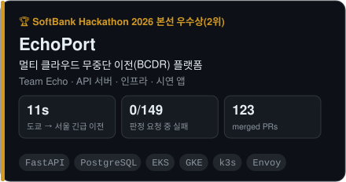
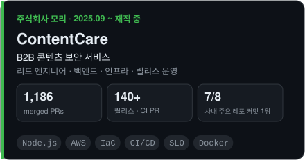
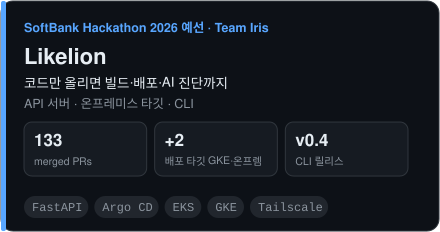
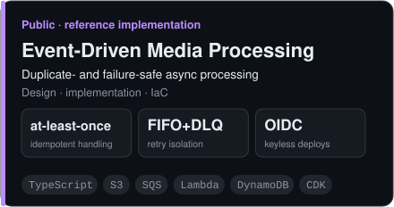

<picture>
  <source media="(prefers-color-scheme: dark)" srcset="assets/header-dark.svg"/>
  <source media="(prefers-color-scheme: light)" srcset="assets/header-light.svg"/>
  
</picture>

## 🎯 Now & Next

**지금** — 회사에서 B2B 서비스의 서버와 운영 환경을 함께 맡고 있습니다. 기능 개발과 함께 배포 · 릴리스, 모니터링과 알림, 권한 관리처럼 서비스가 멈추지 않게 하는 일의 비중이 점점 커지고 있습니다.

**다음** — 회사가 커지면 트래픽도, 처리해야 할 작업량도 커집니다. 그래서 지금은 두 방향을 준비하고 있습니다.

**1. 대규모 트래픽 분산 처리**
- **부하 분산 · 오토스케일링**: 트래픽이 몰려도 응답 시간을 지키는 확장 구조
- **비동기 처리**: 무거운 작업을 큐로 떼어 내 요청 경로를 가볍게
- **데이터 계층 확장**: 커넥션 풀링 · 읽기 분산 · 캐시
- **측정으로 정하는 확장**: 부하 테스트와 서비스 목표(SLO)로 한계를 먼저 재고 확장 시점을 정하기

**2. 온프레미스 + 클라우드 하이브리드**
- **꾸준한 작업은 온프레미스, 몰리는 순간은 클라우드**: 상시 부하는 직접 운영하는 서버에서 싸게 처리하고, 급증분만 클라우드로 넘기기
- **무거운 연산의 온프레미스 처리**: GPU처럼 클라우드 비용이 큰 작업을 사내 서버로 돌리는 구조
- **같은 방식으로 다루는 환경**: 온프레미스도 클라우드와 같은 컨테이너 · GitOps · 관측 방식으로 배포하고 지켜보기
- **끊겨도 이어지는 연결**: 인바운드 포트 없이 터널 · VPN으로 연결하고, 장애가 나면 클라우드가 이어받기

해커톤에서 이미 일부를 해 봤습니다. EchoPort에서는 온프레미스 k3s를 Cloudflare Tunnel로 연결해, 케이블을 뽑으면 클라우드가 이어받고 다시 꽂으면 사람 손 없이 돌아오게 만들었습니다(전환 약 19초). Likelion에서는 사용자 온프레미스 서버를 Tailscale로 등록해 클라우드 클러스터와 같은 GitOps로 배포했습니다. 이 경험과 클라우드 간 단계별 트래픽 전환 · 커넥션 풀링 경험을 실제 서비스 규모로 넓혀 가는 중입니다.

<picture><source media="(prefers-color-scheme: light)" srcset="assets/divider-light.svg"/></picture>

## 🧭 What I bring

| 영역 | 해 온 것 |
|---|---|
| **백엔드** | 서비스 API와 플랫폼 제어부(control plane) API를 설계 · 구현합니다. 감사 로그 · 멱등성 · 실패 기록을 처음부터 넣습니다 (Node.js · FastAPI) |
| **인프라 · IaC** | 손으로 만든 리소스는 Terraform · CDK로 옮기고, 키 대신 OIDC로 배포하고, Argo CD로 맞춥니다 |
| **배포 플랫폼** | 해커톤에서 배포 플랫폼 두 개를 만들며 서버와 인프라를 맡았습니다 — 멀티 클라우드 무중단 이전(EchoPort), GitOps 원클릭 배포(Likelion) |
| **운영** | 회사에서 릴리스 트레인과 CI 러너를 운영하고, 서비스 목표(SLO) 위반 알림과 런북을 둡니다. 「됐다」 대신 실측 · 실패 요청 수 · 롤백 경로로 말합니다 |
| **관측** | OpenTelemetry 수집기와 Prometheus remote write를 세 환경(AWS · GCP · 온프레미스)에 같은 방식으로 붙였습니다 |
| **보안** | 작업별 최소 권한 IAM, 이미지 취약점 게이트(Trivy), OSV 피드 기반 CVE 감시 |

<picture><source media="(prefers-color-scheme: light)" srcset="assets/divider-light.svg"/></picture>

## 📌 Featured

<a href="https://github.com/Softbank-Hackathon-2026-Team-Echo"><picture>
  <source media="(prefers-color-scheme: dark)" srcset="assets/cards/echoport-dark.svg"/>
  <source media="(prefers-color-scheme: light)" srcset="assets/cards/echoport-light.svg"/>
  
</picture></a>
<a href="#mori"><picture>
  <source media="(prefers-color-scheme: dark)" srcset="assets/cards/contentcare-dark.svg"/>
  <source media="(prefers-color-scheme: light)" srcset="assets/cards/contentcare-light.svg"/>
  
</picture></a>

<a href="https://github.com/2026-softbank-1"><picture>
  <source media="(prefers-color-scheme: dark)" srcset="assets/cards/likelion-dark.svg"/>
  <source media="(prefers-color-scheme: light)" srcset="assets/cards/likelion-light.svg"/>
  
</picture></a>
<a href="https://github.com/Saccharine1211/event-driven-media-processing-demo"><picture>
  <source media="(prefers-color-scheme: dark)" srcset="assets/cards/media-pipeline-dark.svg"/>
  <source media="(prefers-color-scheme: light)" srcset="assets/cards/media-pipeline-light.svg"/>
  
</picture></a>

<picture><source media="(prefers-color-scheme: light)" srcset="assets/divider-light.svg"/></picture>

## 🩺 Troubleshooting log

> 운영 중에 직접 원인을 찾고 고친 장애입니다. 링크를 누르면 원인 분석과 적용 기록이 남은 PR로 갑니다.

| 문제 | 원인 | 해결 | 결과 |
|---|---|---|---|
| DB 이전 중 AWS PgBouncer → GCP DB 연결 **시간 초과** | 보조 ENI 파드의 패킷이 주 ENI 주소로 SNAT되어 VPC가 버림 (kube-proxy DNAT가 CNI connmark보다 먼저 적용) | EKS vpc-cni 외부 SNAT 켜기, 노드 2대 순차 재시작 | 경로 복구, 적용 중 손님 요청 **149건 실패 0** · [PR](https://github.com/Softbank-Hackathon-2026-Team-Echo/echo-infra/pull/141) |
| 컷오버 리허설에서 **쓰기 공백 약 23초** | PgBouncer RESUME 뒤 `server_login_retry` 기본값 15초를 기다림 (14.7초) | 재시도 간격 15 → 1초, 쓰기 담당 반대쪽부터 순차 적용 | 본선 리허설 쓰기 정지 **10초 전후 · 쓰기 실패 0** · [PR](https://github.com/Softbank-Hackathon-2026-Team-Echo/echo-infra/pull/143) |
| 보안 게이트가 **세 환경 배포를 모두 차단** | 베이스 이미지의 `apt`에서 HIGH 취약점 새로 발견 (앱 코드와 무관) | 실행 이미지에서 패키지 관리자(apt · pip) 제거 | HIGH 취약점 제거, apt에 새 취약점이 나와도 다시 막히지 않는 구조 · [PR](https://github.com/Softbank-Hackathon-2026-Team-Echo/echo-demo-app/pull/5) |

<picture><source media="(prefers-color-scheme: light)" srcset="assets/divider-light.svg"/></picture>

## 💼 Experience

### 🏆 SoftBank Hackathon 2026 본선 우수상(2위) — Team Echo 2026.10.30 ~ 11.08

> 재난이 오면 돌아가는 서비스를 AWS · GCP · 온프레미스 사이에서 **멈추지 않고 옮기고**, 끝나면 같은 절차로 되돌리는 멀티 클라우드 BCDR 플랫폼 **[EchoPort](https://app.echoport.uk)**. 제어부 API 서버와, 그 API가 다루는 세 환경의 인프라 · 이전 엔진을 맡았습니다.
>
> 운영 결과: 긴급 이전 **AWS 도쿄 → GCP 서울 11초, 판정 요청 149건 중 실패 0건**
>
> `FastAPI` `PostgreSQL` `Terraform` `EKS` `GKE` `k3s` `Envoy` `PgBouncer` `cert-manager` `OpenTelemetry` `Cloudflare Tunnel`

<b>주요 작업 펼쳐보기</b>

**멀티 클라우드 인프라 ([echo-infra](https://github.com/Softbank-Hackathon-2026-Team-Echo/echo-infra))**
- 손으로 만든 실행기 비밀 · Cloudflare · cert-manager를 **Terraform으로 이전**, AWS LB Controller IAM 코드화
- 고객 워크로드 전용 GKE 클러스터를 제어부와 분리하고, 서울 DB를 그 클러스터로 이동
- 진입점: GKE 공유 진입점 인증서를 cert-manager **DNS-01 와일드카드**로, 서비스별 Envoy 가중치 · host 격리, Cloudflare LB 전환 경로
- 세 환경 OpenTelemetry 수집기 + 진입점 Prometheus remote write
- 온프레미스 k3s를 아무 리눅스 기기에 같은 방법으로 세우고, 인바운드 포트 없이 터널로 연결
- CI는 클라우드 키 없이 OIDC로 인증, 실행기 신원 · 권한 · 라벨 정책 분리

**이전 엔진 · 데이터 전환**
- 트래픽 이전 6단계(5 → 10 → 25 → 50 → 75 → 100%) — 단계마다 **요청 N건 처리 확인**으로 판정, 실패 시 자동 롤백
- PostgreSQL 논리 복제 + PgBouncer PAUSE/RESUME으로 DB 쓰기 담당 전환, 컷오버 · 롤백 결과를 DB에 기록
- 컷오버 장애 추적 — EKS vpc-cni 외부 SNAT로 교차 클라우드 DB 경로 타임아웃 해결, 재접속 대기 15 → 1초

**제어부 API ([echo-was](https://github.com/Softbank-Hackathon-2026-Team-Echo/echo-was))**
- 실제 빌드 · 배포 · 내리기 실행기와 EKS · GKE · k3s 접속 확인 어댑터, main push 시 운영 자동 배포
- 실제 지진 피드(USGS) → 피해 환경 서비스의 **긴급 이전 계획 자동 생성**
- 배포 실패 → 격리 샌드박스 AI 진단 → 사람 승인 → 수정 커밋으로 재배포

**보안 · 공급망**
- 환경 × 통제 보안 매트릭스와 기한부 예외 · 감사 로그, OSV 피드 기반 CVE 감시
- 실행 이미지에서 apt · pip를 지워 HIGH 취약점 제거, amd64 · arm64 이미지 GHCR 게시

### 주식회사 모리 — 리드 엔지니어 2025.09 ~ 재직 중

> B2B 콘텐츠 보안 서비스 **ContentCare**를 만들고 운영합니다. 대표 바로 아래에서 서버 개발을 이끌면서 클라우드 인프라 · 릴리스 · 운영까지 맡고 있고, 사내 주요 레포 8곳 중 7곳에서 커밋 수 1위입니다. 사내 레포 14곳에서 **PR 1,186개 병합**. (사내 레포는 비공개라 구조는 적지 않았습니다)
>
> `Node.js` `Python` `AWS` `IaC` `GitHub Actions` `Self-hosted runner` `Docker`

- 서비스 API 서버 설계 · 개발 · 운영
- 운영 클라우드 인프라 코드화, 작업별 최소 권한과 로그 민감정보 가림
- 릴리스 트레인 운영과 배포 자동화 — 셀프 호스티드 CI 러너 직접 운영
- 서비스 목표(SLO) 판정과 위반 알림, 장애 대응 런북
- GPU 작업 자동 기동 · 종료로 비용 관리
- 모바일 앱 빌드와 스토어 출시

### SoftBank Hackathon 2026 예선 — Team Iris 2026.10

> 코드만 올리면 빌드 · 배포 · 장애 진단 · 수정 PR까지 해 주는 GitOps 배포 플랫폼 **[Likelion](https://github.com/2026-softbank-1)**. 플랫폼 API 서버와 멀티 클러스터 배포 타깃 · 온프레미스 연결을 맡았습니다. PR 133개 병합.
>
> `FastAPI` `Argo CD` `ApplicationSet` `Helm` `EKS` `GKE` `Tailscale`

<b>주요 작업 펼쳐보기</b>

- 배포 타깃에 **GCP(GKE)** 와 **사용자 온프레미스 서버** 추가 — ApplicationSet · 게이트웨이 · IAM, Tailscale로 등록 · 연결 자동화, 하트비트로 연결 끊김 표시
- Argo CD가 GitOps push를 webhook으로 바로 받게 해 동기화 지연 제거, 서비스 Pod 종료 전 대기로 무중단 교체
- 온프렘 런타임 로그 · Pod 셸을 Argo CD 경유로 중계하는 **Console Gateway**
- `likelion` CLI 운영 명령 · LLM 에이전트 지원, v0.3 ~ v0.4.3 릴리스

<picture><source media="(prefers-color-scheme: light)" srcset="assets/divider-light.svg"/></picture>

## 🛠️ Stack

**Backend**

  

**Infra · Ops**

  

  
  
  
  
  
  
  
  
  

## 🔄 Recently

<!-- 아래 세 칸은 GitHub Actions(scripts/update_readme.py)가 매일 다시 씁니다. 공개 저장소 활동만 나옵니다. -->
<table><tr><td valign="top" width="34%">

#### 최근 병합한 PR
<!-- recent_prs starts -->
- [fix: EKS vpc-cni 외부 SNAT 켜기 — A PgBouncer→B DB ClusterIP …](https://github.com/Softbank-Hackathon-2026-Team-Echo/echo-infra/pull/141) echo-infra · 2026-11-08
- [chore: 진입점 보조 VM b 제거 — 진입점 VM 하나만 (#112)](https://github.com/Softbank-Hackathon-2026-Team-Echo/echo-infra/pull/144) echo-infra · 2026-11-08
- [perf: 이전 비율 단계 확인 간격 단축(설정)](https://github.com/Softbank-Hackathon-2026-Team-Echo/echo-was/pull/145) echo-was · 2026-11-07
- [feat: 시연 조직 스냅샷·복귀 API](https://github.com/Softbank-Hackathon-2026-Team-Echo/echo-was/pull/142) echo-was · 2026-11-07
- [fix: 실행 이미지의 zlib1g 를 보안 수정판(deb13u1)으로 올린다](https://github.com/Softbank-Hackathon-2026-Team-Echo/echo-demo-app/pull/13) echo-demo-app · 2026-11-07
<!-- recent_prs ends -->

</td><td valign="top" width="33%">

#### 최근 리뷰한 PR
<!-- recent_reviews starts -->
- [feat: 이전 승인·실행 시작 보안 게이트 (보안·거버넌스 5, 기본 꺼짐)](https://github.com/Softbank-Hackathon-2026-Team-Echo/echo-was/pull/61) echo-was · 2026-11-06
- [feat: 빌드 비밀 검사에서 C-SEC-1 비밀 전달 경로 증거를 만든다 (보안·거버넌스 2-4)](https://github.com/Softbank-Hackathon-2026-Team-Echo/echo-was/pull/74) echo-was · 2026-11-06
- [feat: AWS를 GCP에서 구독할 수 있게 열고, 명령어로 적용한 인프라 패치를 코드로 명시화한다.](https://github.com/Softbank-Hackathon-2026-Team-Echo/echo-infra/pull/45) echo-infra · 2026-11-05
<!-- recent_reviews ends -->

</td><td valign="top" width="33%">

#### 최근 작업한 저장소
<!-- recent_repos starts -->
- [echo-infra](https://github.com/Softbank-Hackathon-2026-Team-Echo/echo-infra) EchoPort 인프라와 이전 엔진. Terraform · EKS · GKE · … Softbank-Hackathon-2026-Team-Echo · 2026-11-08
- [echo-demo-app](https://github.com/Softbank-Hackathon-2026-Team-Echo/echo-demo-app) 시연용 관리 대상 앱. 순번 쓰기로 이전 중 누락 · 중복 확인 Softbank-Hackathon-2026-Team-Echo · 2026-11-08
- [echo-ai-agent](https://github.com/Softbank-Hackathon-2026-Team-Echo/echo-ai-agent) EchoPort AI 에이전트 러너. 격리 샌드박스에서 점검 · 수정 · 검증 Softbank-Hackathon-2026-Team-Echo · 2026-11-08
- [echo-was](https://github.com/Softbank-Hackathon-2026-Team-Echo/echo-was) EchoPort 관리 평면 API. 환경 · 배포 · 이전 계획 · 재난 · 보안… Softbank-Hackathon-2026-Team-Echo · 2026-11-08
- [hoshi-words](https://github.com/Shin-Bi/hoshi-words) 별빛 단어 공개 데모 — 직접 작성한 단어·예문과 Flutter 학습 화면, An… Shin-Bi · 2026-11-05
<!-- recent_repos ends -->

</td></tr></table>

## 📊 Activity

<picture>
  <source media="(prefers-color-scheme: dark)" srcset="assets/stats-dark.svg"/>
  <source media="(prefers-color-scheme: light)" srcset="assets/stats-light.svg"/>
  
</picture>

<picture>
  <source media="(prefers-color-scheme: dark)" srcset="https://raw.githubusercontent.com/Saccharine1211/Saccharine1211/output/snake-dark.svg"/>
  
</picture>

통계는 매일 GitHub Actions가 다시 그립니다

